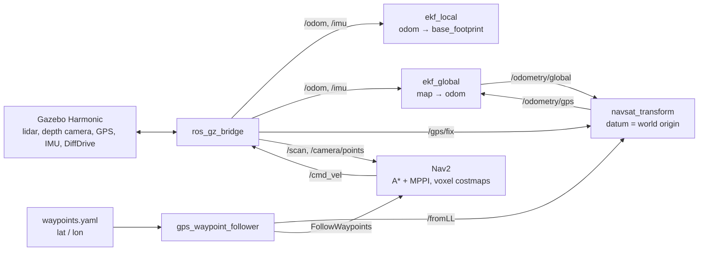

# gps_nav_demo - autonomous A → B drive along GPS waypoints with obstacle avoidance

🇷🇺 [Русская версия](README.ru.md) (also includes answers to the electronics bonus questions)

Test assignment for a «Robot Programmer (ROS/Gazebo)» position. A differential-drive robot in Gazebo starts in zone A,
follows a route given as **GPS coordinates (WGS84)**, avoids obstacles using a **2D lidar** and a
**depth camera** (Orbbec Astra emulation), and stops in zone B.

🎥 **Video** (real speed; RTF ≈ 0.35, so the robot moves slower than real time):

https://github.com/user-attachments/assets/876cc7d8-c2a4-443c-a8db-e25461d0f82a

**Key detail of the scene:** a low 8 cm curb sits *below* the lidar plane (0.20 m). The lidar cannot see it,
the depth camera can - and Nav2 drives around it. This shows why the robot needs both sensors and how they
are fused in a 3D (voxel) costmap.

## Stack

| | |
|---|---|
| OS | Ubuntu 24.04 |
| ROS | **ROS 2 Jazzy** |
| Simulator | **Gazebo Harmonic** (Ignition line) |
| Navigation | Nav2 (A* + MPPI), robot_localization (dual EKF + navsat_transform) |
| Code | Python, xacro (URDF/SDF), YAML |

**Why Jazzy + Harmonic and not Humble:** Jazzy is the current LTS release and the successor of Humble (supported until 2029),
and Harmonic is its official pair; Gazebo Classic is unsupported since January 2025. **The project can be ported to Humble**
(Ubuntu 22.04 + Gazebo Fortress): the rclpy, Nav2, robot_localization and ros_gz APIs are the same; what changes is mostly
the Gazebo system plugin names, the bridge message types (`ignition.*` instead of `gz.*`) and the `/cmd_vel` type
(in Humble Nav2 publishes `Twist`, not `TwistStamped`).

## Quick start

```bash
# 1. Dependencies (Gazebo Harmonic is installed with ros-jazzy-ros-gz)
sudo apt install ros-jazzy-ros-gz ros-jazzy-navigation2 ros-jazzy-nav2-bringup \
  ros-jazzy-robot-localization ros-jazzy-xacro ros-jazzy-robot-state-publisher ros-jazzy-rviz2

# 2. Build
mkdir -p ~/gps_nav_ws/src && cd ~/gps_nav_ws/src
git clone https://github.com/Wexito11/gps_nav_demo.git
cd ~/gps_nav_ws && colcon build --symlink-install && source install/setup.bash

# 3. Run - one command: Gazebo + RViz + localization + Nav2 + mission
ros2 launch gps_nav_demo demo.launch.py

# With rosbag recording (to ~/gps_nav_bags/run_<date>)
ros2 launch gps_nav_demo demo.launch.py record:=true
```

After ~15 s the robot starts moving. Expected mission node log:

```
WP1: lat/lon 55.76589731, 37.68495221 -> map (-3.00, -0.30)
WP2: lat/lon 55.7659, 37.68504142 -> map (2.60, 0.00)
B: lat/lon 55.7659, 37.68513542 -> map (8.50, 0.00)
-> heading to WP1 (1/3)
-> heading to WP2 (2/3)
-> heading to B (3/3)
FINISH: robot is in zone B (0.09 m from centre)
```

## Architecture



**TF tree:** `map → odom → base_footprint → base_link → {lidar_link, camera_link, imu_link, gps_link, wheels}`.
`map→odom` is published by `ekf_global`, `odom→base_footprint` by `ekf_local`, the rest by `robot_state_publisher`.

## Robot - `urdf/rover.urdf.xacro`

Custom xacro model: geometry parameters, macros for wheels, casters and inertia tensors.

| Sensor | Gazebo plugin | ROS topic | Parameters |
|---|---|---|---|
| 2D lidar | `gpu_lidar` | `/scan` | 360°, 360 rays, 0.12-10 m, 10 Hz, σ = 1 cm, height 0.20 m |
| Depth camera (≈ Orbbec Astra) | `rgbd_camera` | `/camera/{image,depth_image,points}` | HFOV 60°, 320×240, depth 0.6-8 m (as Astra), 10 Hz, tilted 0.15 rad down |
| GPS | `navsat` (like `gazebo_ros_gps`) | `/gps/fix` | 5 Hz |
| IMU | `imu` | `/imu` | 50 Hz |
| Drive | `DiffDrive` | `/cmd_vel` (TwistStamped), `/odom` | track 0.34 m, wheel r = 0.08 m |

## World - `worlds/nav_world.sdf.xacro`

- 30×20 m area, zone **A** (−8, 0) green, zone **B** (8.5, 0) red.
- 7 static obstacles on the A→B line: walls, columns, boxes and an **8 cm curb**.
- `spherical_coordinates`: world origin = Bauman University main building (55.7659, 37.6850), ENU axes.
- xacro macros: one obstacle = one line.

## Localization - `config/localization.yaml`

- `ekf_local`: wheel odometry + IMU → smooth `odom→base_footprint` without jumps (for the local costmap and controller).
- `ekf_global`: + GPS → `map→odom`, globally consistent pose.
- `navsat_transform`: **datum = Gazebo world origin**, so the `map` frame matches the world - coordinates in RViz,
  Gazebo and SDF are the same. `use_local_cartesian: true`: at this location the UTM grid (zone 37, central meridian 39°)
  is rotated ~1.1° from north, which would give ~0.3 m error over 16 m.

## Navigation - `config/nav2_params.yaml`

The file is **generated** by `tools/make_nav2_params.py` from the default Nav2 Jazzy parameters - all changes
are collected and commented in one place.

- **No prebuilt map:** the global costmap is a 30×30 m rolling window, the obstacle map is built online from sensor data.
- **VoxelLayer (3D) in both costmaps**, sources `/scan` + `/camera/points`. In a 2D layer, lidar rays at 0.20 m
  would pass over the curb and clear the camera marks; in 3D each sensor only clears its own height.
- Camera point cloud: points below 4 cm are dropped (floor), marking range 3 m.
- A* planner (NavFn), MPPI controller (batch 1000 - lighter for a laptop), `cmd_vel` as TwistStamped.
- Robot radius 0.30 m, inflation 0.6 m.

## GPS route - `config/waypoints.yaml`, `scripts/gps_waypoint_follower.py`

- Waypoints are given in lat/lon (x/y in world coordinates also supported) - the route changes only in YAML.
- The node waits for a GPS fix, converts points to the `map` frame with the `/fromLL` service (robot_localization),
  orients each point towards the next one, publishes RViz markers, sends the route to Nav2 (`FollowWaypoints`)
  and at the end checks that the robot stopped inside zone B.

## Performance

Ryzen 5 2500U / Radeon Vega 8 / 14 GB: RTF ≈ 0.35-0.6 (Gazebo + RViz + Nav2 + EKF). The whole system runs in
simulation time, so a low RTF slows it down but does not change the behaviour.

Useful checks: `ros2 topic hz /camera/points`, `ros2 run tf2_tools view_frames`.

## Repository structure

```
gps_nav_demo/
├── urdf/rover.urdf.xacro          # robot and sensors
├── worlds/nav_world.sdf.xacro     # world, zones A/B, GPS origin
├── config/
│   ├── bridge.yaml                # Gazebo <-> ROS 2 bridge
│   ├── localization.yaml          # dual EKF + navsat_transform
│   ├── nav2_params.yaml           # generated by tools/make_nav2_params.py
│   └── waypoints.yaml             # route in GPS coordinates
├── launch/
│   ├── sim.launch.py              # Gazebo + robot + bridge + RViz
│   └── demo.launch.py             # everything, one command
├── scripts/gps_waypoint_follower.py
├── tools/make_nav2_params.py
└── rviz/sim.rviz
```

## Limitations and next steps

- GPS has no noise (≈ RTK). For a regular GPS (σ 1-3 m): add sensor noise, correct covariances and larger waypoint tolerances.
- The world is static; dynamic obstacles need clearing/decay tuning in the costmaps.
- The Gazebo Reset button removes the robot (it is spawned by the launch file) - restart the launch to run again.
