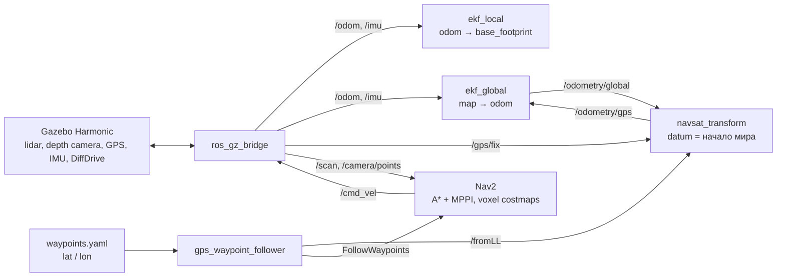

# gps_nav_demo - автономный проезд A → B по GPS-точкам с объездом препятствий

Тестовое задание «Программист робота (ROS/Gazebo)». Дифференциальный робот в Gazebo стартует из зоны A,
проходит маршрут, заданный **GPS-координатами (WGS84)**, объезжает препятствия по данным **2D-лидара** и
**камеры глубины** (эмуляция Orbbec Astra) и останавливается в зоне B.

🎥 **Видео:** <ССЫЛКА_НА_ВИДЕО> (ускорено ×2, см. «Производительность»)

**Главная деталь сцены:** низкий бордюр 8 см стоит *ниже* плоскости лидара (0.20 м). Лидар его не видит,
камера глубины видит - и Nav2 его объезжает. Это показывает, зачем роботу оба сенсора и как они
объединяются в 3D (voxel) карте стоимости.

## Стек

| | |
|---|---|
| ОС | Ubuntu 24.04 |
| ROS | **ROS 2 Jazzy** |
| Симулятор | **Gazebo Harmonic** (линейка Ignition) |
| Навигация | Nav2 (A* + MPPI), robot_localization (dual EKF + navsat_transform) |
| Код | Python, xacro (URDF/SDF), YAML |

**Почему Jazzy + Harmonic, а не Humble:** Jazzy - текущий LTS-дистрибутив и преемник Humble (поддержка до 2029),
Harmonic - его официальная пара; Ignition (новый Gazebo) разрешён заданием, а Gazebo Classic с января 2025
не поддерживается. **При необходимости проект можно перевести на Humble** (Ubuntu 22.04 + Gazebo Fortress):
API rclpy, Nav2, robot_localization и ros_gz те же, меняются в основном имена системных плагинов Gazebo,
типы сообщений моста (`ignition.*` вместо `gz.*`) и тип `/cmd_vel` (в Humble Nav2 публикует `Twist`, а не `TwistStamped`).

## Быстрый старт

```bash
# 1. Зависимости (Gazebo Harmonic ставится вместе с ros-jazzy-ros-gz)
sudo apt install ros-jazzy-ros-gz ros-jazzy-navigation2 ros-jazzy-nav2-bringup \
  ros-jazzy-robot-localization ros-jazzy-xacro ros-jazzy-robot-state-publisher ros-jazzy-rviz2

# 2. Сборка
mkdir -p ~/gps_nav_ws/src && cd ~/gps_nav_ws/src
git clone https://github.com/Wexito11/gps_nav_demo.git
cd ~/gps_nav_ws && colcon build --symlink-install && source install/setup.bash

# 3. Запуск - одна команда: Gazebo + RViz + локализация + Nav2 + миссия
ros2 launch gps_nav_demo demo.launch.py

# С записью rosbag (в ~/gps_nav_bags/run_<дата>)
ros2 launch gps_nav_demo demo.launch.py record:=true
```

Через ~15 с робот начинает движение. Ожидаемый лог узла миссии:

```
WP1: lat/lon 55.76589731, 37.68495221 -> map (-3.00, -0.30)
WP2: lat/lon 55.7659, 37.68504142 -> map (2.60, 0.00)
B: lat/lon 55.7659, 37.68513542 -> map (8.50, 0.00)
-> heading to WP1 (1/3)
-> heading to WP2 (2/3)
-> heading to B (3/3)
FINISH: robot is in zone B (0.09 m from centre)
```

## Архитектура



**Дерево TF:** `map → odom → base_footprint → base_link → {lidar_link, camera_link, imu_link, gps_link, колёса}`.
`map→odom` публикует `ekf_global`, `odom→base_footprint` - `ekf_local`, остальное - `robot_state_publisher`.

## Робот - `urdf/rover.urdf.xacro`

Собственная модель на xacro: параметры геометрии, макросы колёс/опор и тензоров инерции.

| Сенсор | Плагин Gazebo | Топик ROS | Параметры |
|---|---|---|---|
| 2D-лидар | `gpu_lidar` | `/scan` | 360°, 360 лучей, 0.12-10 м, 10 Гц, σ = 1 см, высота 0.20 м |
| Камера глубины (≈ Orbbec Astra) | `rgbd_camera` | `/camera/{image,depth_image,points}` | HFOV 60°, 320×240, глубина 0.6-8 м (как у Astra), 10 Гц, наклон 0.15 рад вниз |
| GPS | `navsat` (аналог `gazebo_ros_gps`) | `/gps/fix` | 5 Гц |
| IMU | `imu` | `/imu` | 50 Гц |
| Привод | `DiffDrive` | `/cmd_vel` (TwistStamped), `/odom` | колея 0.34 м, колёса r = 0.08 м |

## Мир - `worlds/nav_world.sdf.xacro`

- Площадка 30×20 м, зона **A** (−8, 0) зелёная, зона **B** (8.5, 0) красная.
- 7 статических препятствий на прямой A→B: стены, колонны, ящики и **бордюр 8 см**.
- `spherical_coordinates`: начало мира = главный корпус МГТУ им. Баумана (55.7659, 37.6850), оси ENU.
- xacro-макросы: одно препятствие - одна строка.

## Локализация - `config/localization.yaml`

- `ekf_local`: одометрия колёс + IMU → гладкая `odom→base_footprint` без скачков (для локальной карты и контроллера).
- `ekf_global`: + GPS → `map→odom`, глобально согласованная поза.
- `navsat_transform`: **datum = начало мира Gazebo**, поэтому фрейм `map` совпадает с миром - координаты в RViz,
  Gazebo и SDF одинаковы. `use_local_cartesian: true`: в этой точке сетка UTM (зона 37, осевой меридиан 39°)
  повёрнута на ~1.1° относительно севера, на 16 м это дало бы ~0.3 м ошибки.

## Навигация - `config/nav2_params.yaml`

Файл **генерируется** `tools/make_nav2_params.py` из стандартных параметров Nav2 Jazzy - все отличия
собраны и прокомментированы в одном месте.

- **Без заранее построенной карты:** глобальная карта стоимости - скользящее окно 30×30 м, карта препятствий
  строится онлайн по данным сенсоров.
- **VoxelLayer (3D) в обеих картах**, источники `/scan` + `/camera/points`. В 2D-слое лучи лидара на высоте 0.20 м
  проходили бы над бордюром и стирали бы отметки камеры; в 3D каждый сенсор очищает только свою высоту.
- Облако камеры: точки ниже 4 см отбрасываются (пол), дальность отметки 3 м.
- Планировщик A* (NavFn), контроллер MPPI (batch 1000 - облегчён для ноутбука), `cmd_vel` как TwistStamped.
- Радиус робота 0.30 м, инфляция 0.6 м.

## GPS-маршрут - `config/waypoints.yaml`, `scripts/gps_waypoint_follower.py`

- Точки задаются в lat/lon (поддерживается и x/y в координатах мира) - маршрут меняется только в YAML.
- Узел ждёт GPS-привязку, переводит точки во фрейм `map` через сервис `/fromLL` (robot_localization),
  ориентирует каждую точку на следующую, публикует маркеры для RViz, отправляет маршрут в Nav2 (`FollowWaypoints`)
  и в конце проверяет, что робот остановился внутри зоны B.

## Производительность

Ryzen 5 2500U / Radeon Vega 8 / 14 ГБ: RTF ≈ 0.35-0.6 (Gazebo + RViz + Nav2 + EKF). Вся система работает в
симуляционном времени, поэтому низкий RTF замедляет, но не меняет поведение. Видео ускорено ×2.

Полезные проверки: `ros2 topic hz /camera/points`, `ros2 run tf2_tools view_frames`.

## Структура репозитория

```
gps_nav_demo/
├── urdf/rover.urdf.xacro          # робот и сенсоры
├── worlds/nav_world.sdf.xacro     # мир, зоны A/B, GPS-origin
├── config/
│   ├── bridge.yaml                # мост Gazebo <-> ROS 2
│   ├── localization.yaml          # dual EKF + navsat_transform
│   ├── nav2_params.yaml           # сгенерирован tools/make_nav2_params.py
│   └── waypoints.yaml             # маршрут в GPS-координатах
├── launch/
│   ├── sim.launch.py              # Gazebo + робот + мост + RViz
│   └── demo.launch.py             # всё вместе, одна команда
├── scripts/gps_waypoint_follower.py
├── tools/make_nav2_params.py
└── rviz/sim.rviz
```

## Соответствие критериям

| Критерий | Баллы | Реализация |
|---|---|---|
| Модель робота и сенсоров | 2 | собственный xacro, инерции, лидар, камера глубины, GPS, IMU, DiffDrive |
| Gazebo и мир | 1 | мир на xacro, 7 препятствий, зоны A/B, геопривязка |
| ROS: узлы, топики, tf, launch | 2 | мост, дерево TF, dual EKF, 2 launch-файла, свой узел |
| Автономная навигация и объезд | 3 | Nav2 без готовой карты, слияние лидара и камеры в voxel-карте, бордюр |
| GPS / waypoints | 1 | маршрут в lat/lon, `/fromLL`, datum = мир |
| Качество кода и документации | 1 | README, комментарии, генератор параметров |
| Воспроизводимость | 1 | `ros2 launch gps_nav_demo demo.launch.py` |

## Ограничения и что улучшить

- GPS без шума (≈ RTK). Для обычного GPS (σ 1-3 м) - добавить шум в сенсор, корректные ковариации и большие допуски точек.
- Мир статический; для динамических препятствий нужно настроить очистку/затухание в картах стоимости.
- Кнопка Reset в Gazebo удаляет робота (он создаётся launch-файлом) - для повтора перезапустите launch.

## Бонусные вопросы (электроника)

### 1. Подключение Orbbec Astra, ультразвуковых датчиков и GPS к Raspberry Pi 5

- **Orbbec Astra - USB 2.0** (данные и питание по одному кабелю, < 2.4 Вт). Драйвер: OrbbecSDK / ROS 2 `orbbec_camera`.
  Нюанс Pi 5: суммарный ток USB ограничен 600 мА, если источник не 5 В / 5 А (USB-C PD). При питании от DC-DC,
  который реально держит 5 А, можно включить `usb_max_current_enable=1` в `config.txt`.
- **Ультразвук (HC-SR04) - GPIO** (TRIG/ECHO), питание 5 В. ECHO выдаёт 5 В, а GPIO Pi - 3.3 В и не толерантны к 5 В:
  нужен делитель (1 кОм / 2 кОм) или преобразователь уровней. Датчики опрашивать по очереди (иначе взаимные помехи).
  На Pi 5 GPIO идут через чип RP1 - `RPi.GPIO` не работает, использовать `gpiozero` / `lgpio`. Linux не реального
  времени, поэтому при 4+ датчиках лучше вынести опрос на микроконтроллер (RP2040 / ESP32) и передавать расстояния по UART/USB.
- **GPS (u-blox NEO-M8N, для RTK - ZED-F9P) - UART** на GPIO14/15 (логика 3.3 В, `dtparam=uart0=on` → `/dev/ttyAMA0`)
  или USB (`/dev/ttyACM0`). Выход PPS - на GPIO для синхронизации времени (опционально). Антенна с открытым небом.
  Драйвер: `nmea_navsat_driver` или `ublox_gps`.

Итого: USB (камера), UART или USB (GPS), GPIO (ультразвук), I²C (если добавить IMU или датчик тока).

### 2. Питание всех компонентов от одного аккумулятора

Пример: аккумулятор 4S Li-ion (14.8 В) с BMS → предохранитель → выключатель → две ветви:

1. **Силовая:** драйверы моторов напрямую от батареи.
2. **Логика:** DC-DC (buck) 5.1 В / 5 А (≥ 25 Вт) → Pi 5 и 5-вольтовые датчики (ультразвук, GPS).

Бюджет шины 5 В: Pi 5 до ~12 Вт под нагрузкой, Astra < 2.4 Вт, GPS ~0.5 Вт, каждый HC-SR04 ~0.1 Вт →
≈ 15-17 Вт, преобразователь на 25 Вт даёт запас.

Правила: общая земля «звездой»; моторы на отдельной ветви, чтобы пусковые токи и помехи не просаживали 5 В;
конденсаторы на входах DC-DC; мониторинг напряжения и тока (INA219 / INA226 по I²C) и корректное выключение Pi
при разряде.

### 3. Проверка датчиков без ROS

- **Astra:** `lsusb` (vendor ID `2bc5`), затем OrbbecViewer / NiViewer или `pyorbbecsdk` - увидеть карту глубины
  и сверить расстояние до стены с рулеткой.
- **HC-SR04:** скрипт на `gpiozero` (`DistanceSensor(echo=..., trigger=...)`) печатает расстояние - сравнить с
  рулеткой; осциллограф или логический анализатор на ECHO: ширина импульса ≈ 58 мкс на 1 см.
- **GPS:** `screen /dev/ttyAMA0 9600` - должны идти NMEA-строки (`$GNGGA`, `$GNRMC`); в GGA качество фиксации > 0 и
  число спутников. Удобнее `gpsd` + `cgps` / `gpsmon`, для u-blox - u-center.
- **Общее:** `dmesg`, `ls /dev/tty* /dev/video*`, `i2cdetect -y 1`, мультиметр на шинах питания.
